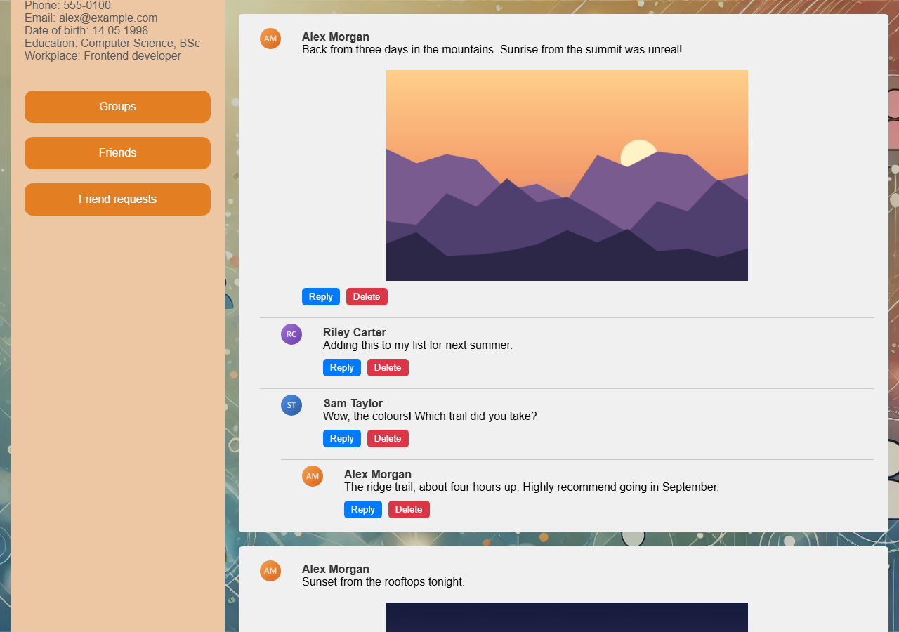
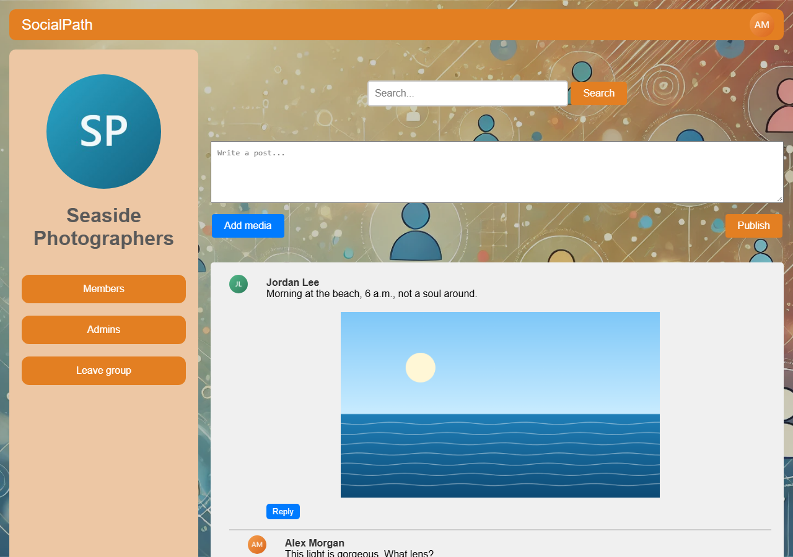
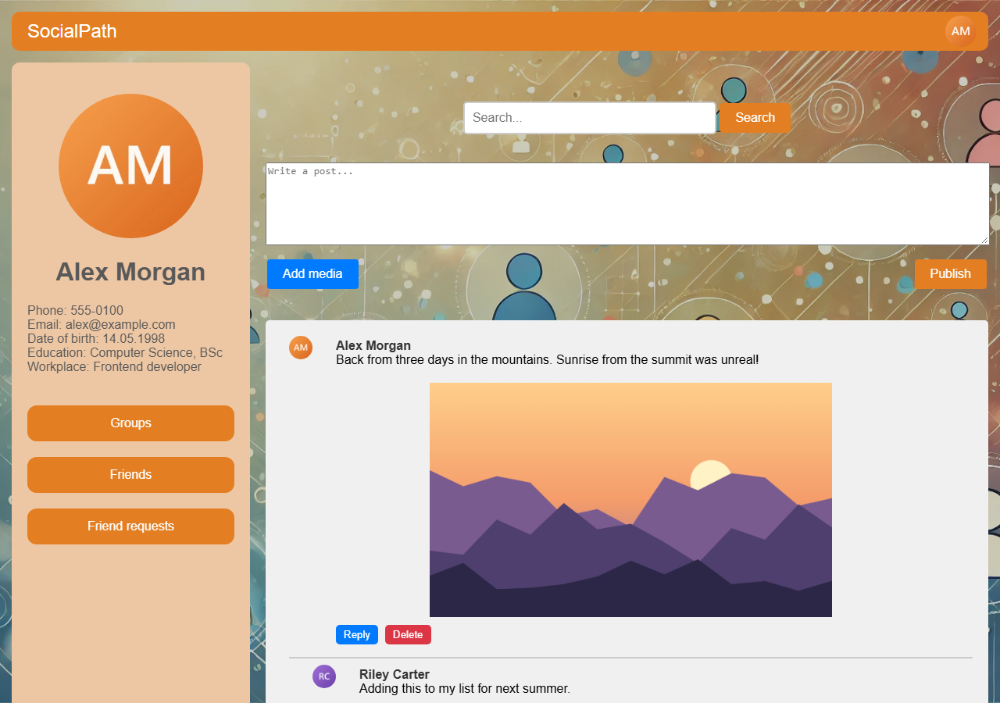
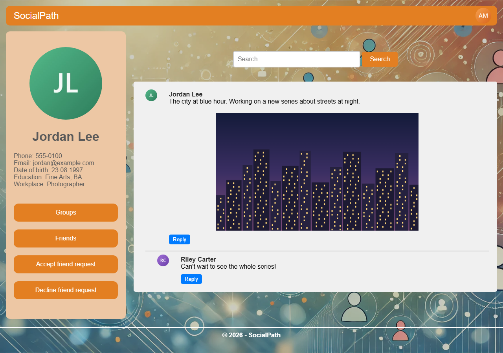

# SocialPath

A social network web application built with Spring Boot and MySQL. Users
create profiles, connect as friends, join groups, publish posts with photos
and video, and discuss them in threaded comments.

| User page with a comment thread | Group feed |
|---|---|
|  |  |
| **Own page** | **Incoming friend request** |
|  |  |

## Features

- **Accounts** — registration with server-side validation, JWT sessions in
  an HttpOnly cookie, password change, profile editing (contacts, birth
  date, country, city, education, workplace).
- **Avatars** — any common format including HEIC and AVIF (decoded with a
  bundled ffmpeg); every upload is center-cropped to a square and stored as
  a 1024 px image plus a 256 px thumbnail for lists, comments and the header.
- **Friends** — requests, accepting/declining, friend lists, removal;
  friendship is always mutual.
- **Groups** — anyone can create a group and becomes its owner; owners
  appoint admins from the members, admins moderate posts and membership.
- **Feed** — posts with up to five photos or an mp4 video, on a user page or
  in a group, with nested comments of unlimited depth.
  - Loads in portions of 20 with infinite scroll.
  - A post, comment or deletion updates only the post it touches, so
    drafts and loaded portions elsewhere stay intact.
  - New posts and comments by others show up on their own at the top of
    the feed; further down a banner offers them instead of moving the page.
- **Search** — one search box across user profiles and group names.

## Tech stack

Java 21 · Spring Boot 3.3 (Web MVC, Security, Validation) · MySQL 8 ·
Spring Data JPA (Hibernate) · Flyway · Thymeleaf · vanilla JavaScript ·
JWT (jjwt) · BCrypt · JUnit 5 + Mockito · Testcontainers · Playwright ·
Checkstyle · GitHub Actions · Docker

## Getting started

The only prerequisite is Docker:

```bash
docker compose up --build
```

Open http://localhost:8080, register a user and explore. To run against
your own MySQL instead, start MySQL 8 on `localhost:3306` and run
`./mvnw spring-boot:run`. Flyway creates and versions the schema on first
start.

Configuration is environment-based:

| Variable      | Default          | Purpose                                  |
|---------------|------------------|------------------------------------------|
| `DB_HOST`     | `localhost`      | MySQL host                                |
| `DB_PORT`     | `3306`           | MySQL port                                |
| `DB_NAME`     | `socialpath`     | Database name                             |
| `DB_USER`     | `root`           | Database user                             |
| `DB_PASSWORD` | `root`           | Database password                         |
| `MEDIA_DIR`   | `./media`        | Directory for uploaded media (a named Docker volume in compose) |
| `JWT_SECRET`  | dev-only default | HMAC key for session tokens — set a long random value in any real deployment |
| `SPRING_PROFILES_ACTIVE` | — | `dev` adds exception messages and stack traces to error responses, for local debugging only |

## Architecture

Classic layered Spring MVC. Thymeleaf renders full pages and the HTML
fragments that small vanilla-JS modules fetch and swap in — no front-end
framework, and forms that need no interactivity (login, profile, group
settings) are plain HTML forms. Controllers stay thin: they receive the
signed-in user as a parameter (`@CurrentUser`, the entity the JWT filter
already loaded) and delegate to services that own validation,
authorization and transactions. Persistence is Spring Data JPA over a
Flyway-versioned schema with Hibernate in `ddl-auto=none`, so the schema
has exactly one owner.

The feed is built in a fixed number of queries per portion: the posts,
the whole comment tree under them in one recursive CTE, the authors as a
projection, and the media in batches; the tree is assembled in memory.
Portions use keyset pagination (`id < last shown`), so posts published
while someone scrolls never shift or duplicate what they already have.
Open feeds poll a single "newest activity by others" id every 30 seconds
while the tab is visible.

Uploaded media lives on the file system (a Docker volume) under
server-generated `{uuid}.{ext}` names. Every file id is validated against a
strict pattern and a normalized-path containment check before any disk
access, so a crafted id cannot escape the media directory.

## Performance

Measured with `show-sql` on a feed of 20 posts with 3 comments each:

| | SQL statements |
|---|---|
| Feed, before (one query chain per post and comment) | 327 |
| Feed, now (any portion size) | 5 |
| Any page, per request for authentication | 4 → 2 |

The last line comes from a classic Spring Boot pitfall: the JWT filter was
a `@Component`, so it was registered both as a servlet filter and inside
the security chain and ran twice per request. Its servlet registration is
now disabled.

## Data model

Nine tables around a natural primary key: `users.login` is immutable,
embedded in JWTs and URLs, and referenced by every relation.

- `friendships` stores mutual friendship as mirrored rows (one per
  direction), making membership checks a simple indexed lookup from either
  side; pending invitations live in `friend_invites`.
- `social_groups` (named so because `GROUPS` is a reserved word in MySQL 8)
  with `group_members` and `group_admins` join tables; the owner is always
  present in both. Joining and leaving are single `INSERT`/`DELETE`
  statements, idempotent thanks to the composite primary keys.
- `publications` holds posts **and** comments in one table with a
  self-referencing `parent_id` (adjacency list): a comment is simply a
  publication with a parent. A row's placement is expressed by its columns —
  `author_login` for user pages, `group_id` for group feeds, `parent_id`
  for replies. Attached files are ordered rows in `publication_media`.
- Deleting a post is one root `DELETE`: `ON DELETE CASCADE` atomically
  removes the reply subtree and its media rows. The application handles the
  part the database cannot — files on disk: their ids are collected up
  front with a single recursive CTE over the subtree, and the files are
  removed only after the transaction commits, so a rollback never leaves
  rows pointing at deleted files.
- `countries` is an ISO 3166 reference table for profile countries.

## Security

- **Authentication** — login issues a JWT stored in an `HttpOnly`, `Secure`,
  `SameSite=Strict` cookie set by the server; the token never passes through
  front-end JavaScript, and `SameSite=Strict` doubles as the CSRF defence
  for the cookie-based session.
- **Passwords** — BCrypt (strength 12).
- **Authorization from stored data only** — permissions never trust ids the
  client sends along. Where a comment lives is read from the top-level post
  of its thread, so a comment cannot be posted to, or deleted from, a feed
  the user has no rights in. Only members post in a group, only the owner
  manages it and appoints admins (from its members), and the owner cannot
  leave their own group.
- **Errors** — denied and missing resources render 403/404 pages for page
  requests and JSON errors for REST calls; stack traces and exception
  messages never reach the client outside the `dev` profile.
- **Validation** — Bean Validation with externalized messages on dedicated
  form DTOs (e.g. `RegistrationForm` owns the plaintext-password rules;
  the date of birth is assembled and checked on the server), while entity
  constraints describe the stored data, so JPA's persist-time validation
  stays enabled as a second line of defence.

## Testing & CI

- **Unit tests** (JUnit 5 + Mockito) cover the security-sensitive and
  tricky paths: JWT handling, every authorization rule of the comment and
  group endpoints, feed assembly and paging, the deletion invariant (media
  of the whole subtree is cleaned up), avatar processing including HEIC and
  AVIF, and date-of-birth validation.
- **Integration test** — boots the full context against a real MySQL via
  Testcontainers, exercising the Flyway migrations end to end.
- **Browser tests** (Playwright, `e2e/`) drive the running app the way a
  user does: sign-up and login, profile editing, the feed with infinite
  scroll and live updates, comments, groups and roles, friends and search,
  including the permission rules as seen from the UI.

GitHub Actions runs two jobs on every push: `build` (unit and integration
tests plus Checkstyle) and `e2e` (the app started with `docker compose`,
then Playwright; on failure the report, screenshots and traces are kept as
an artifact). The multi-stage Dockerfile builds a slim runtime image
running as a non-root user.

Running the tests locally:

```bash
./mvnw verify              # unit + integration tests (needs a Docker daemon)

cd e2e                     # browser tests, with the app up via docker compose
npm ci
npx playwright install chromium
npx playwright test
```

`BASE_URL` points the browser tests at another instance (default
`http://localhost:8080`). The screenshots above are produced by
`npm run screenshots` in `e2e/`, which fills an empty instance with demo
data and captures the pages.
