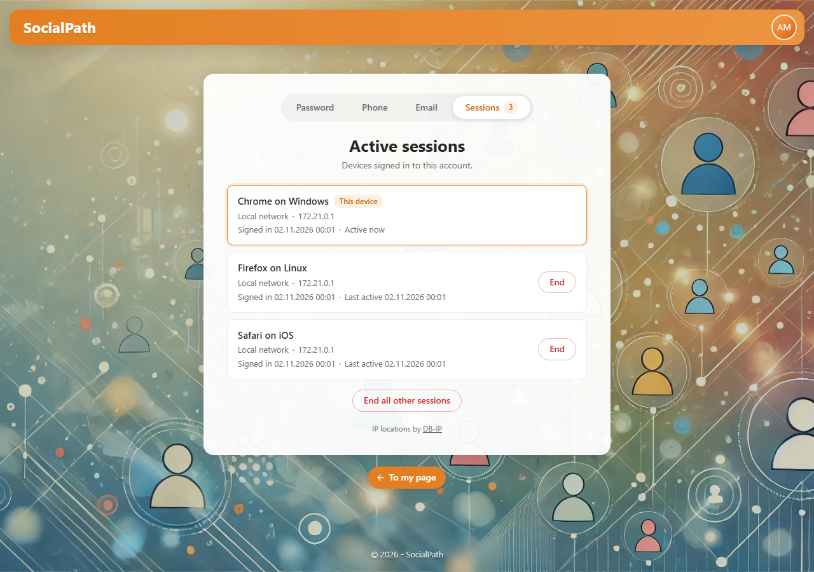
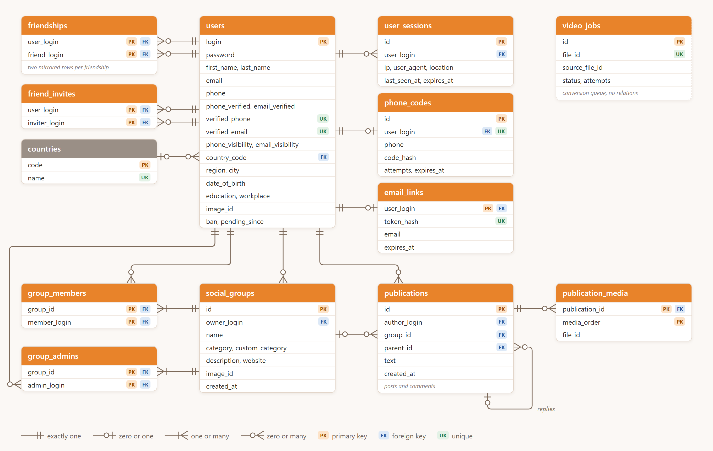

# SocialPath

A small social network built with Spring Boot and MySQL. Users create profiles, add friends, join groups, publish posts with photos
or video and discuss them in threaded comments. Accounts are confirmed by
phone and email, and every signed-in device can be seen and signed out.

| Own page | Comment thread |
|---|---|
|  |  |
| **Group** | **Another user's page with a friend request** |
|  |  |
| **Active sessions** | **Phone confirmation on sign-up** |
|  |  |

## Tech stack

Java 21 · Spring Boot 4.1 (Web MVC, Security, Validation, Data JPA) ·
MySQL 8.4 · Flyway · Thymeleaf · vanilla JavaScript · JWT · libphonenumber ·
ffmpeg · JUnit 5 + Mockito · Testcontainers · Playwright · Checkstyle ·
GitHub Actions · Docker

## Features

- **Profiles** — name, contacts, date of birth, country, city, education,
  workplace and an avatar. The owner chooses who sees the phone number and
  the email address: everyone, friends or only them.
- **Phone and email** — sign-up is finished with a 6-digit code sent to
  the phone; the email address is confirmed by a link in a letter. Once
  confirmed, either one can be used to sign in instead of the login.
  There is no real SMS provider: codes go to a demo phone page
  (`/dev/sms`), and letters to a local [Mailpit](https://mailpit.axllent.org/)
  inbox (or a real mailbox over SMTP, if configured).
- **Security page** — password change, phone and email confirmation, and
  a list of active sessions (browser, system, IP, approximate location)
  where any other device can be signed out.
- **Friends** — requests, accepting or declining, removal.
- **Groups** — the creator owns the group and appoints admins from its
  members; admins moderate posts and members. A group has a topic,
  a description and a website link.
- **Feed** — posts with up to five photos or one video, on a user page or
  in a group, with comments nested to any depth. The feed loads 20 posts
  at a time with infinite scroll, and new posts and comments from others
  appear without a page reload.
- **Media** — avatars in any common format, HEIC and AVIF included, are
  cropped to a square and stored in two sizes. Videos in formats browsers
  can't play (MOV, AVI, MKV, …) are converted to MP4 by ffmpeg in a
  background queue.
- **Search** — one search box for people and groups.

## Running it

The only prerequisite is Docker:

```bash
docker compose up --build
```

| | |
|---|---|
| App | http://localhost:8080 |
| Demo phone (SMS codes) | http://localhost:8080/dev/sms |
| Test inbox (letters) | http://localhost:8025 |

Flyway creates the schema on first start. Without Docker, start MySQL 8 on
`localhost:3306` and run `./mvnw spring-boot:run`.

Configuration comes from environment variables:

| Variable | Default | Purpose |
|---|---|---|
| `DB_HOST`, `DB_PORT`, `DB_NAME` | `localhost`, `3306`, `socialpath` | MySQL connection |
| `DB_USER`, `DB_PASSWORD` | `root`, `root` | MySQL credentials |
| `MEDIA_DIR` | `./media` | Uploaded files (a Docker volume in compose) |
| `JWT_SECRET` | dev-only value | Key for signing session tokens; set your own outside local use |
| `SESSION_TIMEOUT` | `7d` | How long an unused session lives |
| `SMS_DEMO_INBOX` | `true` in compose | Turns on the demo phone page |
| `MAIL_*` | Mailpit | SMTP settings for a real mailbox (see `application.properties`) |
| `GEOIP_DATABASE` | `./geoip/dbip-city-lite.mmdb` | Offline IP location database; the Docker image downloads it |

## How it's built

- **Layers** — Thymeleaf renders whole pages and the HTML fragments that
  small JavaScript modules load and swap in; there is no front-end
  framework. Controllers are thin and pass work to services, which own
  validation, permission checks and transactions.
- **Feed queries** — a page of the feed takes a fixed number of queries:
  posts, the whole comment tree under them in one recursive CTE, authors,
  and media. Pagination is by id (`id < last shown`), so new posts don't
  shift what has already been loaded.
- **Media** — files live on disk under generated names. The type is
  detected from the file's first bytes, not from its name, and file paths
  are checked so that a crafted id can't leave the media folder.

## Database

MySQL with 13 tables. The schema is versioned with Flyway migrations;
Hibernate never changes it (`ddl-auto=none`).

- **`users`** — the login is the primary key: it never changes and is
  used in links and in every relation.
- **`friendships`** — a friendship is stored as two mirrored rows, one
  per direction, so "are they friends" is one indexed lookup from either
  side. Pending requests are in `friend_invites`.
- **`social_groups`**, **`group_members`**, **`group_admins`** — groups
  and their roles; the composite primary keys make joining and leaving
  a single `INSERT` or `DELETE`.
- **`publications`** — posts and comments in one table. A comment is a
  publication with a `parent_id`, so threads can be nested to any depth;
  attached files are ordered rows in `publication_media`. Deleting a post
  is one `DELETE`: `ON DELETE CASCADE` removes all replies and their media
  rows, and the files on disk are removed after the transaction commits.
- **Confirmed phone and email** — a number or address may be typed by
  several accounts but confirmed by only one: a generated column holds it
  while it is confirmed (`NULL` otherwise) and has a unique key.
  `phone_codes` and `email_links` keep the pending code or link as a hash.
- **`user_sessions`** — one row per signed-in browser; the JWT carries its
  id. **`video_jobs`** — the queue of videos waiting for conversion.
  **`countries`** — ISO 3166 reference list.



## Security

- The JWT lives in an `HttpOnly`, `Secure`, `SameSite=Strict` cookie and
  never reaches JavaScript.
- Each token points to a session row in the database, so signing out,
  ending a session or changing the password takes effect immediately.
- Passwords are hashed with BCrypt. SMS codes are stored as BCrypt hashes
  (10 minutes, 5 attempts), email links as SHA-256 hashes (24 hours,
  single use).
- A failed sign-in doesn't tell whether the login, number or address
  exists.
- Permissions are checked against stored data only: for example, where
  a comment may be posted is decided by the post it belongs to, not by ids
  sent from the browser.
- Error pages never show stack traces (only in the `dev` profile).
- IP locations come from the offline [DB-IP](https://db-ip.com) Lite
  database (CC BY 4.0), so addresses are not sent anywhere.

## Tests

- **Unit tests** (JUnit 5 + Mockito) — authentication and sessions,
  permission rules for groups and comments, feed assembly, media
  processing, validation.
- **Integration tests** (Testcontainers + MySQL) — repository queries and
  Flyway migrations, including one test that checks how a migration fills
  in data on an existing database.
- **Browser tests** (Playwright, `e2e/`) — sign-up with phone and email
  confirmation, profile, feed, comments, groups and roles, friends,
  search, sessions and uploads.

GitHub Actions runs everything on each push to `main` and on pull requests: unit and
integration tests with Checkstyle, then the browser tests against the app
started with Docker Compose.

```bash
./mvnw verify              # unit + integration tests (needs Docker)

cd e2e                     # browser tests
npm ci
npx playwright install chromium
npm run stack:up           # a separate app + MySQL + Mailpit on port 8081
npx playwright test
npm run stack:down         # removes it together with the test data
```

The browser tests use their own Compose project (`docker-compose.e2e.yml`),
so they never touch the data on port 8080. The screenshots above are made
by `npm run screenshots` in `e2e/`, which fills that empty stack with demo
data and captures the pages.

## License

[MIT](LICENSE)
